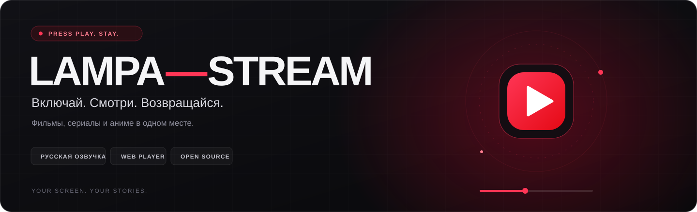
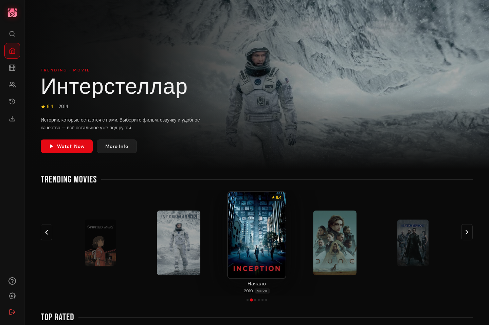
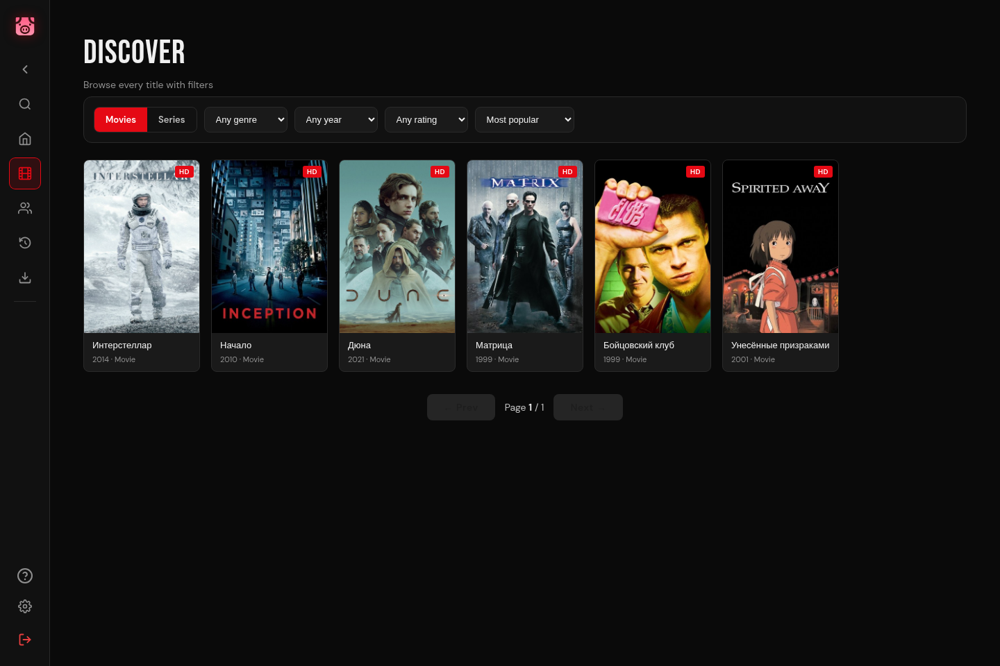

<div align="center">



# Lampa-Stream

**`вечер свободен · фильм выбран · можно смотреть`**

Веб-приложение для фильмов, сериалов и аниме: интерфейс **Streambert**,
онлайн-плеер с русской озвучкой и каталог **TMDB**.
Выбирайте историю, переключайте дорожки и возвращайтесь к просмотру с сохранённой позиции.

    [](LICENSE)

**[▶ Открыть сайт](https://lampa-stream-six.vercel.app)** · [Развернуть свою копию](DEPLOY.md) · [Сообщить о баге](https://github.com/AlexandrCherezau/lampa-stream/issues/new/choose)

</div>

<p align="center">
  <a href="#preview">Интерфейс</a> ·
  <a href="#features">Возможности</a> ·
  <a href="#quickstart">Запуск</a> ·
  <a href="#player">Плеер</a> ·
  <a href="#deploy">Деплой</a> ·
  <a href="#structure">Устройство проекта</a>
</p>

---

<a id="preview"></a>
## ✦ На экране



<p align="center"><sub>Главная страница · демонстрационный каталог, без личной истории и данных аккаунта.</sub></p>



<details>
<summary><b>Ещё: мобильный экран и совместный просмотр</b></summary>

<br>

<table>
  <tr>
    <td align="center" width="30%"><br><sub>Мобильный интерфейс</sub></td>
    <td align="center" width="70%"><br><sub>Смотрим вместе</sub></td>
  </tr>
</table>

Мобильный экран и экран комнаты — существующие снимки интерфейса из репозитория.

</details>

---

<a id="features"></a>
## ✦ Один экран — разные истории

| | Что есть |
| :--- | :--- |
| **🎬 Каталог** | Фильмы, сериалы, аниме, поиск, подборки и карточки с описанием. Метаданные и постеры предоставляет TMDB. |
| **🎧 Озвучка** | Русские озвучки и переключение аудиодорожек, если они доступны у источника. |
| **▶ Плеер** | HLS / DASH, качество, скорость, субтитры, перемотка и полный экран. До 4K при наличии такого потока. |
| **↩ Продолжить** | Сохранение позиции просмотра, история и библиотека. |
| **⏭ Пропуск сцен** | Метки AniSkip для аниме и IntroDB для фильмов и сериалов: вступления, рекапы, титры и сцены после титров. Доступен ручной и автоматический режим, когда для выпуска есть данные. |
| **👥 Вместе** | Комнаты совместного просмотра, синхронизация воспроизведения и чат. Для своего деплоя нужна настройка сервиса комнат. |
| **📱 На любом экране** | Адаптивный интерфейс для компьютера и телефона. |

> [!NOTE]
> Качество, озвучки, субтитры и метки пропуска зависят от выбранного источника и конкретного выпуска.
> Приложение не хранит видео: каталог и воспроизведение используют внешние сервисы.

<a id="quickstart"></a>
## ✦ Начать просмотр

1. Откройте **[lampa-stream-six.vercel.app](https://lampa-stream-six.vercel.app)**.
2. Если включён вход по паролю, введите пароль сайта.
3. Добавьте свой **TMDB Read Access Token** — [как его получить](tmdb-tutorial.md).
4. Выберите фильм или серию и запустите просмотр.

### Локальная разработка веб-версии

Нужны **Node.js ≥ 22.12** и npm.

```bash
git clone https://github.com/AlexandrCherezau/lampa-stream.git
cd lampa-stream
npm ci --ignore-scripts
npx vercel dev
```

[`vercel dev`](https://vercel.com/docs/cli/dev) запускает приложение вместе с serverless-маршрутами `api/`.
При первом запуске CLI предложит привязать локальную копию к проекту Vercel.
Установка с `--ignore-scripts` пропускает загрузку Electron, который для веб-версии не нужен.

Собрать статический фронтенд:

```bash
npm run build
```

<details>
<summary><b>Только интерфейс, без serverless API</b></summary>

```bash
npx vite --host 127.0.0.1
```

Так можно работать с интерфейсом; маршруты `api/` нужно обслуживать отдельно.
Для каталога и совместного просмотра используйте `vercel dev` или свой настроенный backend.

</details>

<a id="player"></a>
## ✦ Плеер под рукой

**Источники** — собственный онлайн-каталог с русскими озвучками, выбором дорожки и качества. Видео передаётся через отдельный source host; внутренние ссылки поставщиков не попадают в браузер. Collaps сохранён как резервный источник. Доступность зависит от конкретного фильма, серии и провайдера.

| Клавиша | Действие |
| :--- | :--- |
| `Space` / `K` | Воспроизвести или поставить на паузу |
| `←` / `J` · `→` / `L` | Перемотать на 10 секунд назад или вперёд |
| `↑` / `↓` | Изменить громкость |
| `F` | Полный экран |
| `M` | Выключить или включить звук |
| `<` / `>` | Изменить скорость |
| `A` · `C` · `Q` | Аудиодорожки · субтитры · качество |

<details>
<summary><b>Desktop-наследие и TorrServer</b></summary>

Проект вырос из Electron-приложения Streambert. В исходниках и настройках остаются
компоненты TorrServer, интеграция с Jackett и настройки внешних плееров.
В веб-сборке эти desktop-источники недоступны; для просмотра в браузере используется онлайн-плеер.

Исторические установщики находятся в [релизах](https://github.com/AlexandrCherezau/lampa-stream/releases).
Они относятся к desktop-версии и не заменяют актуальный веб-деплой.

</details>

### Новый онлайн-источник

Браузерный поиск и просмотр уже работают через отдельный source host на Vercel: собственный Node API, закреплённый Lampac и скрытый браузер работают в контейнере. Крупные видео проходят через отдельный Cloudflare Worker. Воспроизведение использует непрозрачные ссылки; внутренние адреса источников не передаются клиенту.

Для Fight Club и BB через Vibix подтверждены декодирование и перемотка на 60-й секунде; BB/Vibix также прошёл браузерные проверки кадра и меню. Для Fight Club backend передал длительность 139 минут из тестовых метаданных, а исходный VeoVeo отдал полный поток 8349 секунд: браузер декодировал 17 кадров и успешно перемотал на 60-ю секунду. Защита отсеивает finite VOD, если его длительность меньше половины ожидаемой; live-потоки и случаи без известной длительности требуют отдельной проверки. У ZetflixDB плейлист доступен, но сегмент через Worker завершается ошибкой; Zetflix выдаёт озвучки, но их облачное воспроизведение пока не подтверждено. Свежий Haikyuu S1E14 прошёл воспроизведение и перемотку в скрытом браузере. Предыдущая проверка S3E1 и кнопки пропуска не подтверждала сезон: AniMedia возвращал первый сезон, и такой ответ теперь отбрасывается. Правильный S3E1 остаётся открытым. Проверены отдельные серии, а не весь каталог.

Исправлен выбор источников для аниме: теперь доступны и общие русскоязычные провайдеры. Haikyuu S1E14 через Vibix/Onibaku прошёл облачное декодирование 720p и перемотку на минуту. Другой заявленный сезон и явно помеченные заглушки источника отбрасываются до воспроизведения. Повторный S3E1 на правильном сезоне не прошёл проверку перемотки и остаётся открытым. Неизвестная длительность прямых файлов и раздельные сезонные каталоги остаются ограничениями; [подробности проверки](docs/source-host-plan.md).

<a id="deploy"></a>
## ✦ Свой киноэкран

Импортируйте репозиторий в **Vercel**:

| Настройка | Значение |
| :--- | :--- |
| Framework | Vite |
| Build command | `npm run build` |
| Output directory | `dist` |
| API | Serverless-функции из `api/` |

Пароль сайта необязателен. Комнатам совместного просмотра требуется отдельная конфигурация,
описанная в **[руководстве по деплою](DEPLOY.md)**.

В веб-версии TMDB-токен сохраняется в `localStorage` вашего браузера.
Проверка пароля на клиенте служит простым входным экраном, а не полноценной серверной авторизацией.

<a id="structure"></a>
## ✦ Внутри проекта

```text
lampa-stream/
├── api/               # TMDB, онлайн-источник и комнаты
├── src/
│   ├── components/    # Плееры и элементы интерфейса
│   ├── pages/         # Главная, каталог, фильмы, сериалы, библиотека
│   ├── utils/         # API-клиенты, настройки и работа с воспроизведением
│   ├── web/           # Браузерный bridge и экран входа
│   └── styles/        # Темы и адаптивное оформление
├── public/            # Иконки и статические ресурсы
├── docs/              # Обложка и скриншоты
└── vercel.json        # Маршрутизация и настройки деплоя
```

**React 18 + Vite 7** для интерфейса · **hls.js + dash.js** для видео ·
**TMDB** для каталога · **AniSkip** для меток вступлений.

Хотите помочь? [Правила участия](CONTRIBUTING.md) ·
[Баги и идеи](https://github.com/AlexandrCherezau/lampa-stream/issues).

<a id="credits"></a>
## ✦ Авторы и лицензия

Основано на **[truelockmc/streambert](https://github.com/truelockmc/streambert)**.
Интеграции онлайн-плеера и TorrServer вдохновлены Lampa.
Оформление README вдохновлено **[AngelOS-Dotfiles](https://github.com/MixaDoDs/AngelOS-Dotfiles)**;
обложка создана для Lampa-Stream.

Код распространяется по **[GPL-3.0](LICENSE)**. Названия, постеры и кадры произведений
принадлежат их правообладателям; изображения в демонстрации интерфейса получены из TMDB.

---

<div align="center">

**Хорошего просмотра.**

[Открыть сайт](https://lampa-stream-six.vercel.app) ·
[Вернуться наверх](#lampa-stream)

</div>
